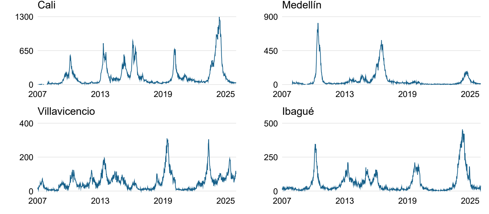
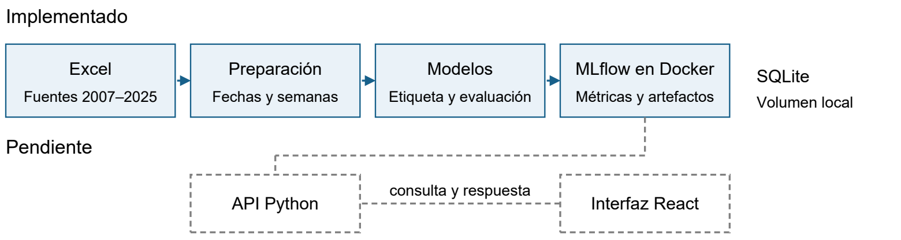
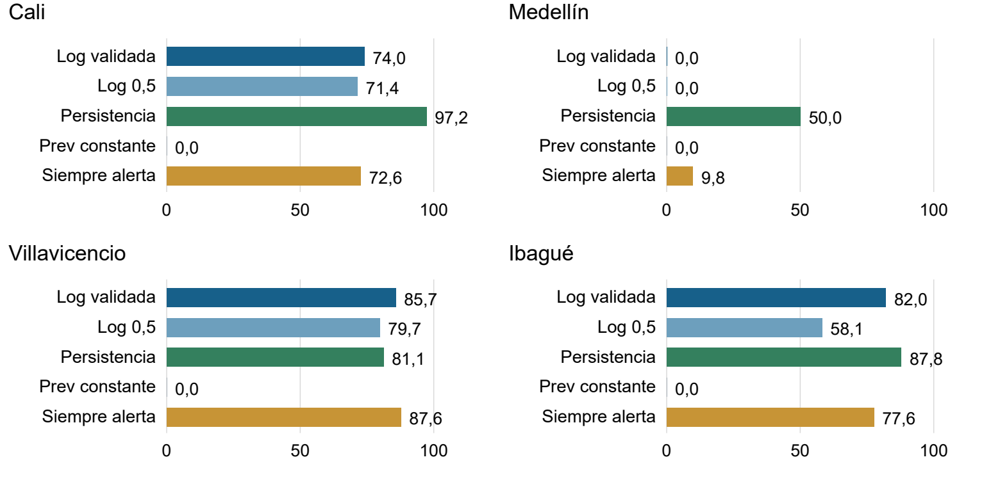
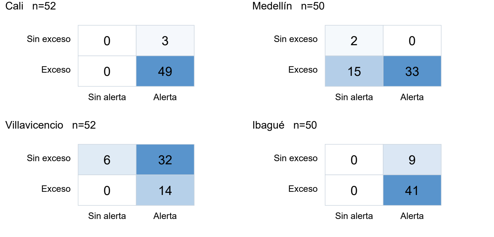

# Sistemas de alertas tempranas para detectar excesos de dengue en Colombia

Informe de avance al 24 de octubre de 2026

Universidad de los Andes. Programa de posgrado: ____________________

| Autores | Correo institucional |
| --- | --- |
| Fabian Andrés Gullaván | |
| Sebastian Caballero | |
| Jhon Alejandro Zuluaga | |
| Juan Sebastian Garcia | j.garciao@uniandes.gov.co |

Proyecto propuesto por el Grupo de Investigación en Biología Matemática y Computacional BIOMAC, Departamento de Ingeniería Biomédica [1].

## 1 Descripción breve de la propuesta de solución

### Resumen

El proyecto busca anticipar excesos semanales de dengue y apoyar la preparación de recursos sanitarios. Se estima si los registros de la semana siguiente, agrupados por inicio de síntomas, superarán el percentil 75 (P75) de esa misma semana en los cinco años anteriores. Ese historial define el exceso; el modelo utiliza semanas recientes y calendario para anticiparlo. La solución contempla modelos municipales independientes, una interfaz de programación de aplicaciones (API) en Python y una aplicación web en React. Se analizaron diecinueve archivos de 2007–2025, se auditaron fechas y duplicados y se reconstruyeron series semanales de Cali, Medellín, Villavicencio e Ibagué. Los años 2007–2011 aportan antecedentes al canal histórico; las semanas elegibles de 2012–2021 se usan para entrenamiento, 2022–2023 para validación y 2024–2025 para evaluación posterior. Se ajustó una regresión logística por ciudad con diez predictores y se compararon dos umbrales de alerta y tres referencias simples. F1 resume el equilibrio entre sensibilidad y precisión; no es el porcentaje global de aciertos. En validación, los F1 fueron 82,0 % en Cali, 0 % en Medellín, 81,8 % en Villavicencio y 82,7 % en Ibagué. La logística detectó, respectivamente, 25 de 36, ninguno de 2, 54 de 61 y 31 de 38 excesos semanales. La persistencia del último conteo obtuvo mayor F1 en las cuatro ciudades. Se registraron veinte ejecuciones verificadas en MLflow sobre Docker. Se propone continuar con Cali, Villavicencio e Ibagué y optimizar la logística antes de compararla con otros modelos, incluido un perceptrón multicapa, para controlar falsas alarmas y comprobar estabilidad temporal.

Palabras clave: dengue; alerta temprana; series temporales; aprendizaje automático; MLflow.

### Introducción y objetivos

La propuesta de BIOMAC busca anticipar excesos de dengue [1]. El objetivo es construir un flujo reproducible que estime su probabilidad a una semana por municipio. Se busca depurar fuentes, definir una etiqueta trazable, comparar modelos con referencias simples y exponer resultados en una API y una interfaz web. Este avance aporta series auditadas y modelos iniciales; la API y React siguen pendientes.

<!-- pagina -->

## 2 Recolección y preparación de los datos

### Fuentes y alcance efectivo

Se recibieron 19 archivos Excel `Datos_2007_210.xlsx` a `Datos_2025_210.xlsx`, asociados a SIVIGILA, el Sistema Nacional de Vigilancia en Salud Pública, con registros individuales de dengue, evento 210 [1], [2]. La propuesta inicial planteaba agregados mensuales, es decir, un total por municipio y mes hasta 2024; las fuentes recibidas permiten construir series semanales hasta 2025. Clima y población aún no se integran.

La extracción conserva 21 campos, archivo y fila de origen, y una huella digital SHA-256 de las 69 columnas originales. El código de país 170 corresponde a Colombia [9]. En `Estado_final_de_caso`, 2 significa probable, 3 confirmado por laboratorio y 5 confirmado por nexo epidemiológico, según las etiquetas de los archivos y el diccionario del INS [2]. El conteo semanal `casos` suma los registros incluidos de esas tres categorías cuyo inicio de síntomas ocurrió en esa semana; no cuenta solo confirmados ni infecciones que nunca se notificaron.

Se excluyen duplicados exactos, registros de otro evento, país o municipio, estados distintos de 2, 3 y 5, e inicios de síntomas ausentes, inválidos o fuera del calendario epidemiológico 2007–2025. En estas extracciones solo se retiraron 20 registros: 13 sin fecha de inicio interpretable y 7 fuera del calendario. Los demás filtros no produjeron exclusiones adicionales. Las notificaciones anteriores a síntomas no se excluyen automáticamente.

| Ciudad | Extraídos | Incluidos | Sem sin filas | Sem elegibles |
| --- | --- | --- | --- | --- |
| Cali | 160.709 | 160.703 | 19 | 709 |
| Medellín | 56.884 | 56.877 | 54 | 652 |
| Villavicencio | 53.422 | 53.417 | 1 | 726 |
| Ibagué | 57.321 | 57.319 | 3 | 708 |

Tabla 1. Registros extraídos e incluidos y semanas sin filas o elegibles para el modelo. Las semanas elegibles tienen etiqueta y diez predictores completos. Fuente: auditorías del proyecto [7].

Figura 1. Notificaciones incluidas por semana de inicio de síntomas, 2007–2025. Las escalas verticales son propias de cada ciudad. Los espacios sin línea representan ausencia de registros, no ceros certificados.

<!-- pagina -->

### Fechas y calendario epidemiológico

Se usa la fecha de inicio de síntomas (`INI_SIN`). No puede interpretarse en 5 registros de Cali, 6 de Medellín, 2 de Villavicencio y ninguno de Ibagué: son fechas faltantes o inválidas, no semanas ni casos adicionales. Esas filas se excluyen sin reemplazar la fecha por notificación.

Cuando ambas fechas son interpretables, no se observaron síntomas posteriores a consulta. En el archivo de 2013 hay notificaciones fechadas antes de los síntomas: 7.069 en Cali, 1.267 en Medellín, 2.165 en Villavicencio y 2.195 en Ibagué. Se conservan para agrupar por síntomas, pero se señalan para no tratarlas como una cronología de notificación confiable.

Cada ciudad tiene 992 filas, una por semana de domingo a sábado entre 2007 y 2025 [8]. Si una semana no tiene registros, su conteo se deja desconocido; no se supone cero. La semana 53, que solo existe en algunos años, permanece en la secuencia. Su conteo puede servir como antecedente reciente, pero sin cinco valores históricos comparables no se asigna la etiqueta de exceso. El panel tiene 28 columnas y diez predictores.

### Trabajos relacionados y brecha

Umaña et al. [3] muestran que ventana histórica, años epidémicos y ceros afectan el canal endémico en Colombia. Fundamentan justificar la etiqueta y estudiar su sensibilidad. Nuestro P75 no reproduce su canal geométrico; sus métricas por brotes no son directamente comparables con nuestro F1 semanal.

EWARS, sistema de alerta y respuesta temprana, vincula vigilancia e indicadores de alarma con respuesta al dengue [4]. Motiva evaluar oportunidad y utilidad. La brecha del piloto es separar definición histórica del exceso, predicción y alerta en un flujo municipal reproducible, aún sin clima ni validación prospectiva.

## 3 Descripción del proceso de construcción de los modelos o solución

### Historia reciente y referencia histórica

Un rezago es un valor de una semana anterior al objetivo: `lag_1` es el conteo de la semana previa; `lag_4`, el de cuatro semanas atrás. Para anticipar la semana 20, el promedio reciente usa las semanas 16–19, mientras que el P75 usa la semana 20 de los cinco años anteriores. Son fuentes con funciones distintas.

Hay exceso observado si el conteo objetivo supera estrictamente su P75. El modelo estima su probabilidad usando los diez predictores siguientes. La alerta se emite al alcanzar el corte de probabilidad seleccionado; 0,5 es una referencia de decisión, no el P75. Se predice exceso semanal, no diagnóstico individual ni conteo exacto.

| Grupo de variables | Construcción y disponibilidad |
| --- | --- |
| Rezagos 1 2 3 4 8 y 12 | Seis conteos de semanas anteriores al objetivo. |
| Media y desviación de cuatro semanas | Dos resúmenes calculados después de desplazar una semana. |
| Seno y coseno de la semana | Dos variables del ciclo anual conocido, considerando años de 52 o 53 semanas. |

Tabla 2. Predictores anteriores al objetivo y calendario conocido. Los cinco conteos anuales definen el P75; no entran directamente al clasificador. Tampoco se usa el conteo de la semana objetivo como predictor.

<!-- pagina -->

### Entrenamiento y evaluación temporal

Por ciudad se ajusta `StandardScaler` y una regresión logística L2 (`C=1`, `lbfgs`, máximo de 2.000 iteraciones, semilla 42) [5]. El escalador usa solo entrenamiento; la regularización limita coeficientes extremos. Es una primera familia interpretable y de bajo costo. No se mezclan ciudades.

| Ciudad | Entrenamiento 2012–2021 | Validación 2022–2023 | Prueba 2024 | Adicional 2025 |
| --- | --- | --- | --- | --- |
| Cali | 501 (175) | 104 (36) | 52 (49) | 52 (0) |
| Medellín | 458 (178) | 94 (2) | 50 (48) | 50 (35) |
| Villavicencio | 518 (175) | 104 (61) | 52 (14) | 52 (48) |
| Ibagué | 515 (173) | 93 (38) | 50 (41) | 50 (1) |

Tabla 3. Semanas elegibles y excesos entre paréntesis. Se usan cuatro bloques cronológicos, no cuatro entrenamientos. Los datos 2007–2011 construyen la historia necesaria para etiquetar desde 2012.

En 2012–2021 se aprenden el escalador y los coeficientes. En 2022–2023 se elige el corte de alerta, sin volver a ajustar coeficientes. En 2024 se evalúa fuera del ajuste y de la selección de corte; 2025 examina el comportamiento en otro año. Estos últimos resultados ya se observaron y no deben reutilizarse para ajustar parámetros y luego presentarse como pruebas nuevas.

El corte se selecciona por F2 en validación entre 0,10 y 0,90, cada 0,05; un empate favorece el mayor. F2 prioriza sensibilidad, sin controlar por sí solo falsas alarmas. Se obtuvieron 0,45 en Cali, 0,90 en Medellín y 0,10 en Villavicencio e Ibagué. Aún no se optimizaron hiperparámetros. Las próximas iteraciones ajustarán regularización y pesos de clases mediante varios cortes temporales de desarrollo, sin seleccionar con 2024–2025.

La evaluación avanza una semana por vez con conteos finales anteriores al objetivo. Evita usar el conteo objetivo como predictor, pero aún no reconstruye qué registros estaban disponibles al emitir la alerta.

### Arquitectura y despliegue alcanzado

Figura 2. Flujo implementado de extracción, preparación, evaluación y seguimiento. La API y la aplicación web corresponden al diseño pendiente; la flecha hacia ellas no representa un servicio ya desplegado.

Se usan Python 3.12 en el entorno de trabajo, pandas, NumPy, scikit-learn 1.9.1, Jupyter y Git. MLflow 3.17.2 está desplegado localmente con Docker Compose, SQLite y un volumen persistente para artefactos [6]. La importación se ejecuta en Docker, monta el repositorio como solo lectura y verifica compatibilidad Windows/Linux. La API prevista en Python y React permitirá seleccionar municipio, semana y parámetros permitidos, consultar probabilidad y umbral y visualizar historia y alertas. Su implementación, pruebas y alojamiento final están pendientes.

<!-- pagina -->

## 4 Resultados obtenidos

### Comparación de referencias y logística en validación

Se comparan cinco métodos por ciudad: alerta permanente; probabilidad constante igual a la prevalencia de entrenamiento; persistencia, que compara el último conteo con el umbral de casos del objetivo; logística con corte 0,5; y la misma logística con corte seleccionado. Son cuatro clasificadores ajustados y veinte ejecuciones de evaluación, no veinte entrenamientos independientes. La persistencia produce una referencia binaria, no una probabilidad calibrada.

Se miden sensibilidad, proporción de excesos detectados; precisión, proporción de alertas correctas; F1, balance entre ambas; F2; especificidad; falsas alarmas (FP) y excesos omitidos (FN). MLflow también conserva precisión promedio (AP), resumen de precisión–recobrado; área ROC, característica operativa del receptor; y Brier, error cuadrático de probabilidad [6], [7]. Estas métricas son descriptivas, no pruebas de significancia estadística.

| Ciudad | Método | Sens % | Prec % | F1 % | FP | FN |
| --- | --- | --- | --- | --- | --- | --- |
| Cali | Log seleccionada | 69,4 | 100,0 | 82,0 | 0 | 11 |
| Cali | Persistencia | 97,2 | 97,2 | 97,2 | 1 | 1 |
| Medellín | Log seleccionada | 0,0 | — | 0,0 | 0 | 2 |
| Medellín | Persistencia | 50,0 | 50,0 | 50,0 | 1 | 1 |
| Villavicencio | Log seleccionada | 88,5 | 76,1 | 81,8 | 17 | 7 |
| Villavicencio | Persistencia | 80,3 | 84,5 | 82,4 | 9 | 12 |
| Ibagué | Log seleccionada | 81,6 | 83,8 | 82,7 | 6 | 7 |
| Ibagué | Persistencia | 86,8 | 91,7 | 89,2 | 3 | 5 |

Tabla 4. Validación 2022–2023. Porcentajes calculados desde las métricas guardadas en MLflow; el guion indica precisión indefinida por ausencia de alertas. Log corresponde al umbral seleccionado.

Figura 3. F2 en porcentaje para las veinte ejecuciones registradas en validación. La comparación relevante se realiza dentro de cada ciudad. Los resultados agregados entre ciudades no representan una clasificación de riesgo ni una prueba de superioridad general.

<!-- pagina -->

### Evaluación posterior y seguimiento de experimentos

| Ciudad | F1 Log 2024 | F1 Pers 2024 | F1 Log 2025 | F1 Pers 2025 | FP Log 2025 |
| --- | --- | --- | --- | --- | --- |
| Cali | 97,0 | 98,0 | — | — | 2 |
| Medellín | 81,5 | 97,9 | 10,8 | 94,3 | 0 |
| Villavicencio | 46,7 | 71,0 | 96,0 | 94,8 | 4 |
| Ibagué | 90,1 | 95,1 | 7,7 | 100,0 | 24 |

Tabla 5. F1 en porcentaje de logística seleccionada y persistencia, y falsas alarmas de logística en 2025. El F1 de Cali en 2025 no está definido porque no hay semanas con exceso bajo esta etiqueta.

Figura 4. Matrices de confusión de 2024 para la logística con corte seleccionado. Las filas representan la clase observada y las columnas la alerta. Fuente: ejecuciones verificadas de MLflow.

En Cali la logística alerta en las 52 semanas de 2024; en Ibagué alerta en las 50 elegibles. Por ello sus F1 altos no demuestran discriminación de semanas sin exceso. En Villavicencio detecta los 14 excesos de 2024, pero genera 32 falsas alarmas. En 2025 alerta en todas las semanas de Villavicencio y en Ibagué alcanza precisión de solo 4,0 %, con 24 falsas alarmas y un único exceso real. Persistencia obtiene 100 % en ese último bloque, pero un solo positivo no acredita estabilidad.

MLflow conserva las veinte ejecuciones como importadas, con parámetros, predicciones semanales, gráficos, configuración, huellas de datos y código disponible al importar. Se descargaron artefactos y se contrastaron probabilidades de los modelos recuperados; repetir la importación reutiliza las ejecuciones existentes. La hora registrada corresponde a importación, no al entrenamiento original. No se subieron microdatos de pacientes. Las métricas no definidas se mantienen ausentes y se explican en el manifiesto.

La evidencia se conserva en la carpeta [informeAvance/datos del repositorio](https://github.com/ProyectoDespliegueMAIA/Model/tree/main/informeAvance/datos): [ejecuciones_mlflow.json](https://github.com/ProyectoDespliegueMAIA/Model/blob/main/informeAvance/datos/ejecuciones_mlflow.json) y [metricas_mlflow.csv](https://github.com/ProyectoDespliegueMAIA/Model/blob/main/informeAvance/datos/metricas_mlflow.csv), con identificadores de ejecución para auditar las cifras. Estas son las rutas de destino al publicar los archivos del avance.

<!-- pagina -->

## 5 Análisis de los resultados obtenidos

### Discusión de hallazgos y dificultades

La principal fortaleza es un flujo trazable que reconcilia registros, conserva ausencias y separa aprendizaje, etiqueta y alerta. El resultado inicial no acredita superioridad de la logística frente a una regla sencilla. En Villavicencio, alerta permanente supera el F2 de logística en validación: una métrica aislada puede premiar demasiadas alertas. Las semanas positivas consecutivas pueden pertenecer al mismo episodio.

Se propone Cali, Villavicencio e Ibagué por continuidad y posibilidad de evaluación, no por el mayor F1 de prueba. Medellín solo tiene dos excesos en validación: F2 es cero en toda la rejilla y el corte 0,90 resulta del desempate. En Ibagué, 37 de 38 excesos corresponden a 2023. Sin población y cobertura verificada, los conteos no equivalen a incidencia.

Los retrasos son una limitación central: agrupar por inicio de síntomas reconstruye el comportamiento epidemiológico, pero un conteo final puede completarse después del corte nominal. Antes de afirmar capacidad de alerta real se debe simular disponibilidad por notificación o aplicar retardos definidos con el experto. Elegir una fecha coherente no elimina el subregistro ni certifica exactitud.

El P75 con cinco antecedentes es sensible a cambios históricos; no constituye un umbral oficial de brote. Las semanas sin registros no deben rellenarse sin evidencia. Se requiere sensibilidad a ventana y percentil, y revisar la semana 53 sin forzar equivalencias. La concentración de positivos y el contraste 2024–2025 muestran que un solo bloque de validación es insuficiente. Los años posteriores ya observados deben tratarse como evaluación exploratoria en decisiones futuras.

### Ajustes y plan de continuidad

Se propone validación con varios cortes temporales de desarrollo, ajustando escalador y modelo solo con el pasado. Se optimizarán hiperparámetros de logística, como intensidad de regularización y pesos de clases, y luego su regla de alerta. Se compararán HistGradientBoostingClassifier y un perceptrón multicapa (MLP), una red neuronal con capas ocultas, mediante `MLPClassifier` [5]. El MLP tendrá una arquitectura pequeña por el tamaño del conjunto. Todas las familias usarán las mismas particiones y referencias; se valorarán falsas alarmas y estabilidad además de F2. Son tareas pendientes, sin garantía de mejora.

| Fecha | Hito | Estado |
| --- | --- | --- |
| 25 oct | Entregar avance con evidencia y registro de experimentos | En curso |
| 26 oct–8 nov | Optimizar logística y comparar HistGradientBoosting y MLP | Previsto |
| 9–19 nov | Implementar API Python e interfaz React y sus pruebas | Previsto |
| 20–26 nov | Integrar, validar y desplegar la solución el 26 de noviembre | Previsto |
| 27 nov | Sustentación del proyecto | Previsto |
| 29 nov | Entrega del informe final | Previsto |

Tabla 6. Hitos de continuidad. La entrega de avance está prevista para el 25 de octubre; los restantes componentes deben completarse antes del despliegue del 26 de noviembre de 2026.

<!-- pagina -->

### Conclusiones y trabajo futuro

El avance reconstruye series semanales de cuatro ciudades, documenta los problemas cronológicos y deja una línea de base verificable. La calidad de inicio de síntomas permite mantener una definición común de fecha, mientras que la ausencia de registros se conserva como incertidumbre. Se propone continuar con Cali, Villavicencio e Ibagué y conservar Medellín para análisis comparativos.

La logística inicial no supera consistentemente a persistencia. El umbral de probabilidad modifica el balance entre detección y falsas alarmas, pero no reemplaza al P75 que define el exceso. La principal lección es que datos, etiqueta y evaluación temporal condicionan las métricas tanto como el algoritmo.

El producto puede apoyar la exploración retrospectiva y, tras validación adicional, la preparación de recursos. Su uso operacional exige comprobar disponibilidad de datos, oportunidad por episodios y carga de alertas. El trabajo futuro incluye optimización de hiperparámetros, comparación explícita con un MLP pequeño y HistGradientBoosting, clima y población, calibración y evaluación prospectiva. La API y React deberán presentar municipio, fecha de corte, probabilidad, regla de alerta y límites de uso, sin sugerir un diagnóstico individual.

### Referencias

[1] Grupo BIOMAC, Universidad de los Andes. Propuesta de proyecto en Ingeniería Biomédica Sistemas de alertas tempranas para la detección de exceso de casos en enfermedades vectoriales Una mirada al dengue en Colombia. Documento suministrado al proyecto, s. f.

[2] INS y SIVIGILA. Registros del evento 210 de 2007–2025, suministrados al proyecto y documentados en los manifiestos. [Estructura de salidas Excel del INS](https://www.ins.gov.co/BibliotecaDigital/diccionario-xls-.pdf).

[3] J. D. Umaña et al. Endemic Channel Parametrization in Dengue Surveillance: Methodological Assessment of Retrospective Windows, Outbreak Trends, and Zero-Case Periods in Colombia. JMIR Public Health and Surveillance, vol. 12, e79914, 2026. [doi:10.2196/79914](https://doi.org/10.2196/79914).

[4] L. Hussain-Alkhateeb et al. Early warning and response system (EWARS) for dengue outbreaks: Recent advancements towards widespread applications in critical settings. PLOS ONE, vol. 13, no. 5, e0196811, 2018. [doi:10.1371/journal.pone.0196811](https://doi.org/10.1371/journal.pone.0196811).

[5] Scikit-learn developers. LogisticRegression, MLPClassifier y validación temporal. Documentación 1.9.1, consulta del 24 de octubre de 2026. [Validación temporal](https://scikit-learn.org/stable/modules/cross_validation.html#time-series-split) y [regresión logística](https://scikit-learn.org/stable/modules/generated/sklearn.linear_model.LogisticRegression.html) y [MLP](https://scikit-learn.org/stable/modules/generated/sklearn.neural_network.MLPClassifier.html).

[6] MLflow contributors. MLflow Tracking APIs. Documentación del seguimiento de experimentos; versión utilizada 3.17.2, consulta del 24 de octubre de 2026. [Documentación](https://mlflow.org/docs/latest/ml/tracking/tracking-api/).

[7] Equipo del proyecto. Modelo Dengue código y evidencias de preparación evaluación y seguimiento. Repositorio, 2026. [Código y carpeta informeAvance](https://github.com/ProyectoDespliegueMAIA/Model).

[8] Instituto Nacional de Salud. Calendario epidemiológico 2025. [Calendario del INS](https://portalsivigila.ins.gov.co/Documentos%20compartidos/Calendario%202025.pdf).

[9] United Nations Statistics Division. Standard Country or Area Codes M49. Colombia 170. [Tabla M49](https://unstats.un.org/unsd/methodology/m49/overview/).

### Código y anexos reproducibles

Fuente de trabajo: [https://github.com/ProyectoDespliegueMAIA/Model](https://github.com/ProyectoDespliegueMAIA/Model). Los notebooks, `src/dengue`, configuraciones y `docker/mlflow` documentan el flujo. La carpeta [informeAvance](https://github.com/ProyectoDespliegueMAIA/Model/tree/main/informeAvance) reúne texto, figuras y evidencia agregada; su publicación queda a cargo del equipo. Los microdatos están fuera de Git. Seguimiento: [MLflow local](http://localhost:5000/#/experiments/2).
